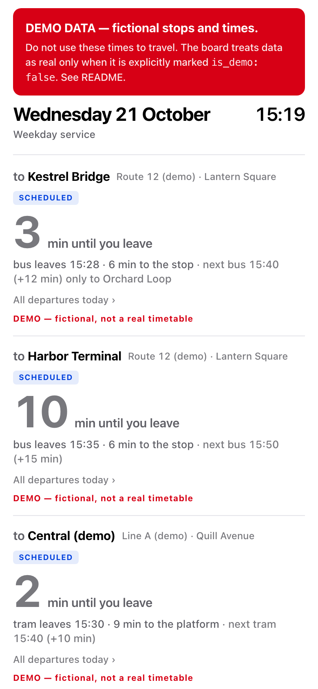
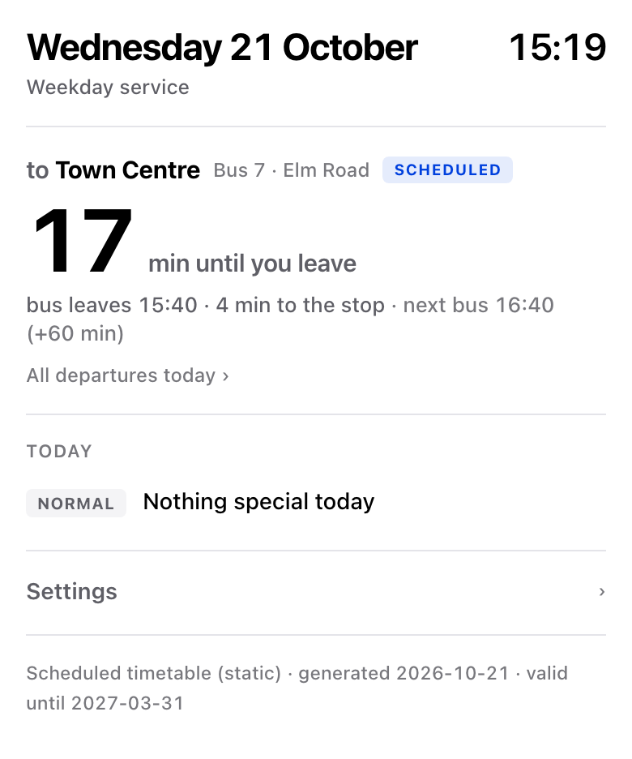

# Transit Board — “when do I have to leave?”

A one-page departure board that answers a single question: **how many minutes until I need to walk out the door?**
It is one HTML file with no build step, no framework, no tracking and no network access of its own.

**Live demo:** <https://nullinbetween.github.io/transit-board/> (fictional demo data)

[繁體中文說明 → README.zh-TW.md](README.zh-TW.md)

<table>
<tr>
<td width="50%"></td>
<td width="50%"></td>
</tr>
<tr>
<td>Out of the box: fictional demo data, permanently marked <b>DEMO</b>.</td>
<td>After the 10-minute tutorial below: your own stop, no banner.</td>
</tr>
</table>

> **This is not a download-and-ride app.** It ships with **no real timetable** and never contacts a
> transit API by itself. To use it for real you add your own local timetable (tutorial below, about
> 10 minutes, or hand it to an AI coding assistant). Until you do, the board keeps showing the DEMO warning — on purpose.

---

## Design notes — how we thought about it

Most transit apps show you a timetable and leave the arithmetic to you. Standing at the door you do not
want a timetable; you want one number.

```
leave_in = next_departure − now − minutes_from_your_door_to_the_stop
```

Everything else follows from taking that one number seriously.

| Decision | Why | Trade-off we accepted |
|---|---|---|
| Show **“leave in N min”**, not departure times | That is the question you actually have at the door. Departure times are one tap away (“All departures today”). | Less information on first glance. |
| **Door-to-stop time is part of the data** and editable per stop | “Walking time” is really walking + waiting for the lift + finding your keys. Only you know it. | Stored per browser (localStorage), not synced. |
| **There is no “no more buses today”** | Late at night is exactly when you most need an answer. The board looks from yesterday’s column up to eight service days ahead and tells you how long until the next run, even if it is “tomorrow 06:10” or, for a weekday-only route on a Saturday, “Mon 06:10”. | The math has to handle service days that end at ~4 a.m. |
| A service day **ends at 4 a.m.**, not midnight | Printed timetables list the 00:15 bus in *Saturday’s* column. `00:15` (or GTFS-style `24:15`) in a column means “after midnight, same service day”. | Data authors must understand this rule (documented in `DATA_FORMAT.md`). |
| Show the **gap to the next bus as a number, not advice** | “Next bus +15 min” lets you decide whether to run. Telling people *what to do* is a judgment that belongs to them. | — |
| **Demo data can never pass as real** | A demo that silently looks real is dangerous. Data counts as real only when it says `is_demo: false` **and** is not the bundled demo dataset. A file merely existing is not enough. | You must opt in explicitly. |
| **Stale data warns loudly** | A board that is confidently wrong is worse than no board. Expired timetables, expired holiday lists and old live data all show warnings. | — |
| **Holidays come from data, with an expiry date** | An early version had a hand-typed holiday list that turned out to be missing a substitute holiday. Uncaught, the board would have silently served the weekday timetable on that day. Now the list must say how far it is valid, and the board warns after that. | You maintain the list. |
| **No third-party proxies, no secrets in the page** | An early version read a private calendar feed through a public CORS proxy. That hands the feed’s secret URL — effectively a password — to a stranger’s server on every page load. It was removed. If you need private data, use a relay you control. | No calendar integration in this release. |
| **The board never fetches by itself** | Transit data differs per city, often needs keys, and has its own licence terms. The board only calls a `loadData()` *you* write. | More setup for you; no surprise network traffic. |
| **Plain HTML, light theme, 5:1 contrast** | Opens instantly on a phone and is readable at a glance. | No dark mode. |

## Quick start (30 seconds)

1. Download or clone this folder.
2. Double-click `transit-board.html`.

You will see the fictional demo board. The browser console shows one harmless “config.local.js not found” error — that file is yours to create.

## Tutorial: your own board in about 10 minutes

You need: your stop(s), the departure times for **weekdays / Saturdays / Sundays & holidays**, and your time zone
(for example `Europe/London`, `Asia/Tokyo`). Where you get the times is up to you — the operator’s website, a
printed timetable, a GTFS file.

### A. Edit one file (no server, works by double-click) — verified

1. Copy `config.example.js` to **`config.local.js`** in the same folder. (`*.local.js` is git-ignored, so your stops never get committed by accident.)
2. Replace its contents with this and edit the stop, line and times:

```js
// config.local.js — my own board
window.TRANSIT_CONFIG = { title: 'My departures' };

window.TRANSIT_DATA = {
  format: 'transit-board/v1',
  dataset_id: 'my-board',
  is_demo: true,                  // keep true while you check the times; step 4 switches it to false
  kind: 'static',
  timezone: 'Europe/London',      // the time zone the timetable is written in
  valid_until: '2027-03-31',      // last day this timetable is valid
  source: 'Typed in from the operator timetable',
  generated: '2026-10-21',        // the day you typed it in
  attribution: [],
  calendar: {
    holidays: { '2026-12-25': 'Christmas Day', '2026-12-26': 'Boxing Day' },
    holidays_until: '2026-12-31'
  },
  stops: [{
    id: 'elm-road',
    label: 'Elm Road',
    walk_min: 4,                  // minutes from your door to the stop
    lanes: [{
      id: 'to-town',
      line: 'Bus 7',
      to: 'Town Centre',
      services: {
        wd: ['06:40', '07:10', '07:40', '08:10', '08:40', '09:40', '10:40', '11:40', '12:40', '13:40',
             '14:40', '15:40', '16:40', '17:10', '17:40', '18:40', '19:40', '21:40', '23:40'].map(t => ({ t })),
        sa: ['08:15', '09:15', '10:15', '11:15', '12:15', '13:15', '14:15', '15:15', '16:15', '17:15', '18:15'].map(t => ({ t })),
        su: ['09:30', '11:30', '13:30', '15:30', '17:30'].map(t => ({ t }))
      }
    }]
  }]
};
```

3. Double-click `transit-board.html`. Check that:
   - there is no “The loaded data cannot be used” message (if there is, it lists exactly which field is wrong);
   - the countdown matches your timetable minus your walking time.

   The red DEMO banner is still there — on purpose: until you say otherwise, the board treats the data as an example.
4. Once the times are your real ones and you have checked them, change `is_demo: true` to `is_demo: false` and reload.
   The DEMO banner disappears and the tab title becomes “My departures”.

More stops or directions: add more objects to `stops` and `lanes`. A bus that only runs part of the way: `{ t: '13:40', short_to: 'Depot' }`.

### B. Keep the times in a spreadsheet (CSV) — verified

If you prefer a spreadsheet, export it as CSV with the header used in `examples/sample-timetable.csv`:

```
stop_id,stop_label,walk_min,lane_id,line,to,day_type,time,short_to
elm-road,Elm Road,4,to-town,Bus 7,Town Centre,wd,07:10,
```

Save it as `my-timetable.csv` next to the board and put this in `config.local.js`:

```js
window.TRANSIT_CONFIG = {
  title: 'My departures',
  refresh_sec: 300,
  loadData: async function () {
    const csv = await (await fetch('my-timetable.csv')).text();
    return TransitAdapters.fromSimpleCsv(csv, {
      is_demo: true,              // switch to false once my-timetable.csv holds your real, checked times
      dataset_id: 'my-board', timezone: 'Europe/London',
      valid_until: '2027-03-31', generated: '2026-10-21',
      source: 'Typed in from the operator timetable'
    });
  }
};
```

Browsers block `fetch()` on pages opened by double-click, so serve the folder instead:

```bash
python3 -m http.server 8765 --bind 127.0.0.1
```

and open <http://127.0.0.1:8765/transit-board.html>.

### C. Hand it to an AI coding assistant

Give an assistant (Claude, Codex, …) this whole folder plus your timetable (text, a spreadsheet or a screenshot) and say:

```text
This is a departure board (transit-board). Read README.md and DATA_FORMAT.md first.
Convert the timetable I attached into the transit-board/v1 format and write it to a new
config.local.js that sets window.TRANSIT_DATA.
- is_demo: true for now — I will switch it to false myself after checking the times
- timezone: "<my time zone, e.g. Europe/London>"
- valid_until: "<last day the timetable is valid, YYYY-MM-DD>"
- walk_min: it takes me <N> minutes to walk to each stop
- if there is a local public-holiday list, fill calendar.holidays and calendar.holidays_until
Do not change transit-board.html or any existing file.
Then tell me how to check the result (no data error, countdown matches the timetable) and where to set
is_demo: false once I have checked it.
```

Check the converted times against your timetable once, then set `is_demo: false`. The board does the arithmetic; it
cannot know if the data is wrong.

### D. Put it on a phone or a tablet by the door — not verified on devices

The board is plain static files, so any static host works (GitHub Pages, Netlify, a home server). Open the URL on the
device and use “Add to Home Screen”. If you publish through git, note that `config.local.js` is git-ignored on purpose
(by two lines in `.gitignore`: `config.local.js` and `*.local.js`). Only if you are comfortable with your stops being
public, add it explicitly in **your own fork** — the ignore rules stay in place for everything else:

```bash
git add -f config.local.js
```

## Static timetables vs live data

| | Static (`kind: "static"`) | Live (`kind: "realtime"`) |
|---|---|---|
| What it is | The published timetable | Predicted arrivals at one moment |
| Goes stale when | The timetable or holiday list changes (`valid_until`) | Within minutes (`max_age_sec`) |
| Shown as | `Scheduled` | `Live estimate` |

For live data, `adapters/realtime-json-adapter.js` is a template; rename its fields to match your API.
Many APIs need a key and block browser requests (CORS). A key in `config.local.js` is visible to anyone who can open
the page, so for anything public use a small relay you control. Do not use public CORS proxies. Whether your region
offers usable data at all varies — this project cannot promise it.

## How it works

- `transit-board.html` contains the UI and a block of pure functions (`<script id="core-logic">`): time-zone handling,
  service-day selection, the candidate list from yesterday up to eight days ahead, validation and freshness checks. The tests load
  exactly that block.
- Data follows one contract, [`DATA_FORMAT.md`](DATA_FORMAT.md) (`transit-board/v1`). It is validated before anything is
  shown; invalid data shows the list of problems and **no departures**.
- Everything coming from data is HTML-escaped; links must be `http(s)`.

## Tests

```bash
python3 -m http.server 8765 --bind 127.0.0.1
```

Open <http://127.0.0.1:8765/tests/core.test.html> — 55 tests (demo marking, time zones, after-midnight service, weekends and holiday runs,
the end of a timetable's validity, holidays and the end of the holiday list, stale data, live data, validation — impossible dates and timestamps, wrong JSON types —
escaping, both adapters, and two UI checks, including “one data request at a time; a slow answer is still applied”). The tab title shows `PASS n/n` or `FAIL`.

## From personal tool to open source

This started as a board configured for the author’s own stops. Preparing it for release meant:

- removing every real place, coordinate and private integration, and replacing them with **fictional demo data that can
  never pass as real**;
- turning hard-coded settings into a documented data format with validation, time zones, static vs live data and two
  example adapters;
- removing the automatic weather call and the built-in holiday list, so the page makes **no network request** unless you add one;
- adding a browser test suite that runs on fictional fixtures only.

Known limits (daylight-saving edge cases, holiday rules, untested browsers) are listed in [`ISSUES.md`](ISSUES.md).

## How it was built

Designed by the author for daily use and written with AI coding assistants. The open-source preparation ran as a small
multi-agent workflow: **Codex** scoped the work and reviewed it independently, **Claude** made allowlisted copies,
removed personal data, fixed defects and wrote the tests and docs, and the author made the final calls.

## Licence

[MIT](LICENSE). Third-party material: none (see [`ASSET_REGISTER.md`](ASSET_REGISTER.md)). Timetable data you add is
subject to its own source’s terms — put any required credit in the data’s `attribution` field.

---

Made by [@nullinbetween](https://x.com/nullinbetween) · apps by meredith · [appsbymeredith.carrd.co](https://appsbymeredith.carrd.co)
